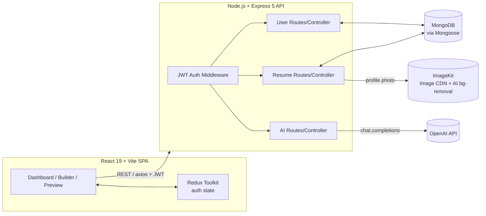
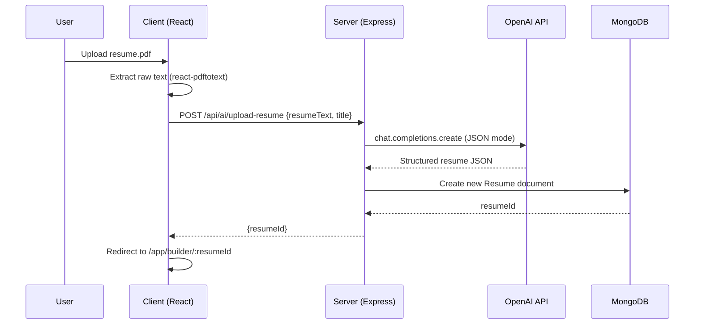
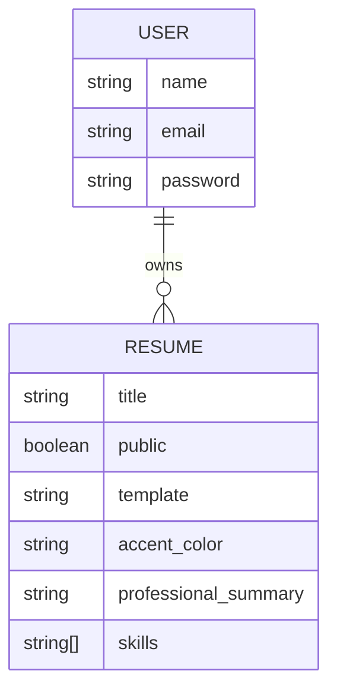

<div align="center">

# 📄 Resume Builder AI

**Build a polished, ATS-friendly resume in minutes — with AI doing the heavy lifting.**

[](https://react.dev/)
[](https://expressjs.com/)
[](https://www.mongodb.com/)
[](https://platform.openai.com/)
[](https://tailwindcss.com/)
[](#license)

[Live Demo](https://resume-builder-ai-zeta.vercel.app/) · [Features](#-features) · [Architecture](#-architecture) · [Getting Started](#-getting-started) · [API Reference](#-api-reference)

</div>

---

## 📌 Overview

Resume Builder AI is a full-stack MERN application that lets job seekers create, customize, and share professional resumes — without starting from a blank page. Users can either build a resume section-by-section through a guided form, or **upload an existing PDF resume and have AI extract and structure all the data automatically**. An integrated OpenAI-powered assistant rewrites professional summaries and job descriptions to be more compelling and ATS-friendly on demand.

The result is a live, themeable resume preview that updates in real time, can be exported to PDF, and can be published as a public, shareable link.

## ✨ Features

| Category | What it does |
|---|---|
| 🤖 **AI Resume Import** | Upload an existing PDF resume — the backend extracts text and uses OpenAI's structured JSON output to auto-fill personal info, experience, education, projects, and skills into a brand-new resume. |
| ✍️ **AI Content Enhancement** | One-click "AI Enhance" rewrites the professional summary and individual job descriptions into concise, action-driven, ATS-optimized copy. |
| 🎨 **Live Template & Theme Switching** | Four distinct templates (Classic, Modern, Minimal, Minimal Image) and a 10-color accent palette, all reflected instantly in the preview pane. |
| 🧩 **Guided, Section-Based Editor** | A step-by-step form (Personal Info → Summary → Experience → Education → Projects → Skills) with progress tracking, so nothing gets missed. |
| 🖼️ **Profile Photo Upload + Background Removal** | Photos are uploaded and optimized via ImageKit, with an optional one-click AI background removal. |
| 🔗 **Public Sharing** | Any resume can be toggled public/private and shared via a unique link or the native device share sheet. |
| ⬇️ **One-Click PDF Export** | Print-ready export straight from the browser. |
| 🔐 **Secure Authentication** | JWT-based auth with bcrypt password hashing and protected API routes. |
| 📊 **Personal Dashboard** | Create, rename, duplicate-edit, and delete resumes from a single dashboard view. |


## 🏗️ Architecture



**Request flow — AI resume import**



## 🧰 Tech Stack

<table>
<tr><td valign="top">

**Frontend**
- React 19 + Vite 7
- Redux Toolkit (auth state)
- React Router 7
- Tailwind CSS v4
- Framer Motion (animation)
- Axios
- react-hot-toast
- react-pdftotext (client-side PDF text extraction)
- lucide-react (icons)

</td><td valign="top">

**Backend**
- Node.js + Express 5
- MongoDB + Mongoose
- JSON Web Tokens (auth)
- bcrypt (password hashing)
- Multer (file upload handling)
- OpenAI Node SDK
- ImageKit Node SDK (image hosting + AI background removal)

</td></tr>
</table>

## 📁 Project Structure

```
resume-builder-ai/
├── client/                      # React SPA
│   ├── src/
│   │   ├── app/                 # Redux store + auth slice
│   │   ├── components/          # Forms, pickers, resume templates
│   │   │   ├── home/             # Landing page sections
│   │   │   └── templates/        # Classic / Modern / Minimal / Minimal-Image
│   │   ├── configs/              # Axios instance
│   │   └── pages/                # Home, Dashboard, ResumeBuilder, Preview, Login
│   └── vite.config.js
└── server/                      # Express API
    ├── configs/                  # DB, OpenAI, ImageKit, Multer setup
    ├── controllers/               # Business logic (user, resume, AI)
    ├── middlewares/                # JWT auth guard
    ├── models/                    # Mongoose schemas (User, Resume)
    ├── routes/                    # /api/users, /api/resumes, /api/ai
    └── server.js
```

## 🚀 Getting Started

### Prerequisites
- Node.js 18+
- A MongoDB instance (local or [MongoDB Atlas](https://www.mongodb.com/atlas))
- An [OpenAI API key](https://platform.openai.com/api-keys)
- An [ImageKit](https://imagekit.io/) account (free tier works) for image hosting

### 1. Clone & install

```bash
git clone https://github.com/<your-username>/resume-builder-ai.git
cd resume-builder-ai

# install server deps
cd server && npm install

# install client deps
cd ../client && npm install
```

### 2. Configure environment variables

Copy the example files and fill in your own values.

```bash
cp server/.env.example server/.env
cp client/.env.example client/.env
```

**`server/.env`**

| Variable | Description |
|---|---|
| `MONGODB_URI` | MongoDB connection string (without trailing slash or DB name — the app appends `/resume-builder`) |
| `JWT_SECRET` | Any long random string used to sign auth tokens |
| `OPENAI_API_KEY` | Your OpenAI secret key |
| `OPENAI_BASE_URL` | OpenAI-compatible base URL (use `https://api.openai.com/v1` for OpenAI directly) |
| `OPENAI_MODEL` | Model name, e.g. `gpt-4o-mini` |
| `IMAGEKIT_PUBLIC_KEY` / `IMAGEKIT_PRIVATE_KEY` / `IMAGEKIT_URL` | From your ImageKit dashboard |
| `PORT` | API port (defaults to `3000`) |

**`client/.env`**

| Variable | Description |
|---|---|
| `VITE_BASE_URL` | Base URL of the running API, e.g. `http://localhost:3000` |

### 3. Run it

```bash
# Terminal 1 — API
cd server
npm run server     # nodemon, auto-restarts on change

# Terminal 2 — Client
cd client
npm run dev
```

The app will be available at `http://localhost:5173`, talking to the API at `http://localhost:3000`.

## 📡 API Reference

All protected routes require an `Authorization` header containing the raw JWT (returned at login/register).

### Auth — `/api/users`

| Method | Endpoint | Auth | Description |
|---|---|---|---|
| `POST` | `/register` | ❌ | Create a new account |
| `POST` | `/login` | ❌ | Authenticate and receive a JWT |
| `GET` | `/data` | ✅ | Get the current user's profile |
| `GET` | `/resumes` | ✅ | List all resumes owned by the current user |

### Resumes — `/api/resumes`

| Method | Endpoint | Auth | Description |
|---|---|---|---|
| `POST` | `/create` | ✅ | Create a blank resume |
| `PUT` | `/update` | ✅ | Update resume fields and/or upload a profile photo (multipart) |
| `DELETE` | `/delete/:resumeId` | ✅ | Delete a resume |
| `GET` | `/get/:resumeId` | ✅ | Fetch a resume owned by the current user |
| `GET` | `/public/:resumeId` | ❌ | Fetch a resume that has been marked public |

### AI — `/api/ai`

| Method | Endpoint | Auth | Description |
|---|---|---|---|
| `POST` | `/enhance-pro-sum` | ✅ | Rewrite a professional summary using AI |
| `POST` | `/enhance-job-desc` | ✅ | Rewrite a job description using AI |
| `POST` | `/upload-resume` | ✅ | Parse raw resume text into a structured resume document |

## 🗃️ Data Model



Each `Resume` embeds `personal_info`, `experience[]`, `education[]`, and `project[]` as sub-documents, keeping a resume fully self-contained in a single document for fast reads.

## 🗺️ Roadmap

- [ ] Cover letter generator
- [ ] LinkedIn import
- [ ] Additional resume templates
- [ ] Per-section AI suggestions (skills, projects)
- [ ] Resume scoring against a target job description

## 🤝 Contributing

Contributions are welcome. Please open an issue first to discuss any significant change, then submit a pull request.

```bash
git checkout -b feature/your-feature
git commit -m "feat: add your feature"
git push origin feature/your-feature
```

## 📄 License

This project is licensed under the [MIT License](LICENSE).

## 👤 Author

Built by **[MD DANISH]** — [GitHub](https://github.com/daniish-ansarii) · [LinkedIn](https://linkedin.com/in/daniish-ansarii) 

</div>
